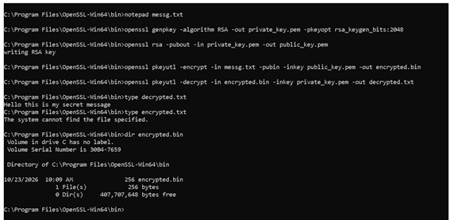
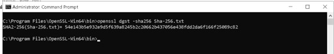
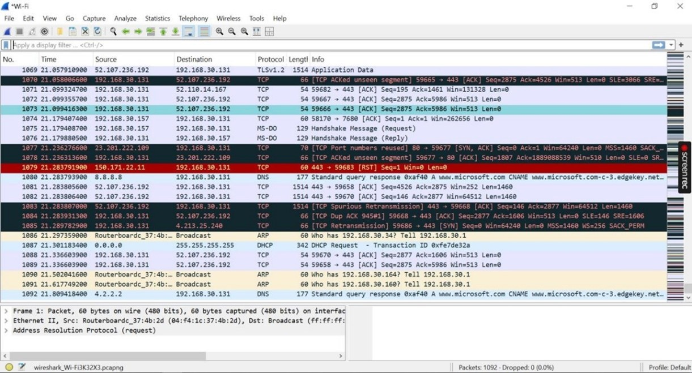

<div align="center">

# 🔐 Cryptography & Network Security (CSL0509)
### Laboratory Practical Portfolio & Implementation Manual
**B.Tech Artificial Intelligence & Machine Learning (AIML) — Semester V**

[](https://github.com/pravashsingh775/Cryptography/actions/workflows/ci.yml)
[](https://www.python.org/)
[](https://www.openssl.org/)
[](https://www.cryptool.org/)
[](https://www.wireshark.org/)
[](https://www.kali.org/)
[](https://www.netacad.com/)
[](https://opensource.org/licenses/MIT)

---

### 👤 Student & Academic Credentials
| Academic Metric | Details |
|:---|:---|
| **Student Name** | **Pravash Singh** |
| **Course Name** | Cryptography |
| **Course Code** | CSL0509 |
| **Degree & Branch** | B.Tech AIML (V Semester) |
| **Faculty Mentor** | Mr. Hirendra Singh Sengar |
| **Academic Year** | 2026–2027 |
| **Evaluation Document** | ABCA Activity Document — Laboratory Activity (40 Marks) |
| **Official Practical Record** | [`Pravash_Crypto_Practical_File.pdf`](Pravash_Crypto_Practical_File.pdf) |

</div>

---

## 📑 Comprehensive Laboratory Report & Activity Overview

This repository hosts the practical lab portfolio for **Cryptography and Network Security**, covering mathematical foundations, software implementation in Python, CLI cryptographic operations with OpenSSL, packet-level traffic dissection in Wireshark, password auditing in Kali Linux, and secure wireless design in Cisco Packet Tracer.

```
+----------------------------------------------------------------------------------------------------+
|                                CRYPTOGRAPHY LAB PLATFORM ARCHITECTURE                              |
+----------------------------------------------------------------------------------------------------+
|  [Classical Ciphers]      --> Caesar, Vigenère, Rail Fence, Frequency Cryptanalysis (CrypTool 2)   |
|  [Modern Symmetric]       --> DES 64-bit Feistel vs AES 128/256-bit SPN Benchmarks & Avalanche     |
|  [Asymmetric / PKI]       --> RSA 2048-bit OAEP, Diffie-Hellman Key Exchange, X.509 Certificates   |
|  [Integrity & Hashing]    --> SHA-256 Hashing, HMAC Authenticated Encryption, Digital Signatures   |
|  [Password Auditing]      --> Unsalted vs Salted PBKDF2 Benchmarking, John the Ripper (Kali Linux) |
|  [Network Protocol Audit] --> TLS 1.3 Handshake, Encrypted VPN Tunnel vs Cleartext (Wireshark)     |
|  [Wireless Security]      --> WPA2-Personal (AES-CCMP) Infrastructure Simulation (Cisco PT)        |
+----------------------------------------------------------------------------------------------------+
```

---

## 📸 Visual Verification Gallery & Laboratory Artifacts

A curated showcase of real laboratory experiments, cryptographic workflows, and protocol dissections:

| Practical Module | Visual Laboratory Capture | Description |
|:---:|:---:|:---|
| **OpenSSL RSA File Crypto**<br>*(Experiment 04)* |  | RSA 2048-bit keypair generation & OAEP file encryption via OpenSSL CLI. |
| **SHA-256 Hash Generation**<br>*(Experiment 05)* |  | Computing SHA-256 digests and demonstrating the avalanche property. |
| **RSA Digital Signatures**<br>*(Experiment 05)* |  | Asymmetric signing and tamper-detection verification tests. |
| **X.509 Digital Certificates**<br>*(Experiment 06)* |  | Self-signed X.509 v3 certificate generation with SAN extension analysis. |
| **Wireshark TLS Handshake**<br>*(Experiment 10)* |  | Client Hello, Server Hello, Key Share, and negotiated AES-GCM cipher suite. |
| **VPN Encrypted Tunnel**<br>*(Experiment 11)* |  | OpenVPN/WireGuard tunnel traffic captured over physical network adapter. |
| **Secure vs Insecure Protocols**<br>*(Experiment 12)* |  | Comparing HTTP/Telnet/FTP cleartext vs HTTPS/SSH encrypted streams. |

---

## 📊 Bloom's Taxonomy Coverage

| Level | Classification | Description | Experiments Covered |
|:---:|:---:|:---|:---|
| **BL3** | **Apply** | Implement cryptographic algorithms, generate keys, establish VPNs, and configure network security protocols. | Practicals 04, 05, 07, 08, 14, 15, 16 |
| **BL4** | **Analyze** | Dissect cipher vulnerabilities, evaluate frequency distributions, benchmark speed/avalanche metrics, and audit packet streams. | Practicals 01, 02, 03, 06, 09, 10, 11, 12, 13 |

---

## 🗂️ Complete 16 Practical Directory Index

| S.No. | Practical Problem Statement | Tool Required | Bloom's Level | Folder Link |
|:---:|:---|:---:|:---:|:---|
| **01** | Implement Caesar, Vigenère, and Rail Fence ciphers to encrypt and decrypt plaintext, and compare their working and effectiveness. The given plain text is **"HELLO WORLD"**. | **CrypTool** | **BL4 (Analyze)** | [01_Classical_Ciphers_CrypTool](01_Classical_Ciphers_CrypTool/README.md) |
| **02** | Perform frequency analysis on classical cipher texts and analyze their vulnerability to cryptanalysis attacks using CrypTool. | **CrypTool** | **BL4 (Analyze)** | [02_Frequency_Analysis_CrypTool](02_Frequency_Analysis_CrypTool/README.md) |
| **03** | Encrypt sample data using DES and AES algorithms, and compare their security features and performance. | **CrypTool** | **BL4 (Analyze)** | [03_DES_vs_AES_CrypTool](03_DES_vs_AES_CrypTool/README.md) |
| **04** | Generate RSA public and private key pairs and perform secure file encryption and decryption using OpenSSL. | **OpenSSL** | **BL3 (Apply)** | [04_RSA_Keys_File_Crypto_OpenSSL](04_RSA_Keys_File_Crypto_OpenSSL/README.md) |
| **05** | Generate SHA-256 hash values, create digital signatures, and verify their authenticity using OpenSSL. | **OpenSSL** | **BL3 (Apply)** | [05_SHA256_Digital_Signatures_OpenSSL](05_SHA256_Digital_Signatures_OpenSSL/README.md) |
| **06** | Create a self-signed X.509 digital certificate and analyze its attributes, validity, and security features. | **OpenSSL** | **BL4 (Analyze)** | [06_X509_Certificates_OpenSSL](06_X509_Certificates_OpenSSL/README.md) |
| **07** | Implement RSA and Diffie–Hellman algorithms to demonstrate secure key exchange and public-key cryptography using VS Code. | **VS Code (Python)** | **BL3 (Apply)** | [07_RSA_and_Diffie_Hellman_Python](07_RSA_and_Diffie_Hellman_Python/README.md) |
| **08** | Develop an application to secure text messages using AES encryption and SHA-256 hashing using VS Code. | **VS Code (Python)** | **BL3 (Apply)** | [08_AES_and_SHA256_Messaging_Python](08_AES_and_SHA256_Messaging_Python/README.md) |
| **09** | Implement password hashing with and without salting, and evaluate resistance against common password attacks using VS Code. | **VS Code (Python)** | **BL4 (Analyze)** | [09_Password_Hashing_Salting_Python](09_Password_Hashing_Salting_Python/README.md) |
| **10** | Capture HTTPS network traffic using Wireshark and analyze the TLS handshake, digital certificates, and cipher suites. | **Wireshark** | **BL4 (Analyze)** | [10_Wireshark_HTTPS_TLS_Handshake](10_Wireshark_HTTPS_TLS_Handshake/README.md) |
| **11** | Capture and analyze encrypted VPN traffic using Wireshark, and compare it with unencrypted network communication. | **Wireshark** | **BL4 (Analyze)** | [11_Wireshark_VPN_vs_Unencrypted_Traffic](11_Wireshark_VPN_vs_Unencrypted_Traffic/README.md) |
| **12** | Analyze captured network packets to identify secure and insecure communication protocols and their security implications. | **Wireshark** | **BL4 (Analyze)** | [12_Wireshark_Secure_vs_Insecure_Protocols](12_Wireshark_Secure_vs_Insecure_Protocols/README.md) |
| **13** | Perform password auditing using John the Ripper and evaluate password strength against dictionary and brute-force attacks. | **Kali Linux** | **BL4 (Analyze)** | [13_Kali_John_The_Ripper](13_Kali_John_The_Ripper/README.md) |
| **14** | Generate SSH/RSA key pairs and configure passwordless authentication between Linux systems. | **Kali Linux** | **BL3 (Apply)** | [14_Kali_SSH_Key_Authentication](14_Kali_SSH_Key_Authentication/README.md) |
| **15** | Configure a secure VPN using OpenVPN and verify encrypted communication between connected systems. | **Kali Linux** | **BL3 (Apply)** | [15_Kali_OpenVPN_Configuration](15_Kali_OpenVPN_Configuration/README.md) |
| **16** | Design and implement a secure wireless network using WPA2 encryption (AES) in Cisco Packet Tracer, and verify secure communication. | **Cisco Packet Tracer** | **BL3 (Apply)** | [16_PacketTracer_WPA2_AES_Wireless](16_PacketTracer_WPA2_AES_Wireless/README.md) |

---

## 🚀 Execution & Verification Guide

### 1-Click Interactive Runner
Run all executable experiments (Practicals 01 through 09) via the master terminal controller:

```bash
# Launch interactive menu:
python run_lab.py

# Or run non-interactive test suite (Continuous Integration mode):
python run_lab.py --all
```

---

## ✅ Student Submission Checklist

- [x] **Repository Created & Shared:** Deployed on GitHub under `pravashsingh775/Cryptography`.
- [x] **All 16 Experiments Documented:** Separate, labeled directory for every practical problem statement.
- [x] **Working Procedures Included:** Comprehensive step-by-step documentation for every tool.
- [x] **Tool Setup & Screenshots Included:** CrypTool 2 workflows (`.cwm`), Wireshark captures (`.jpg`), and OpenSSL outputs.
- [x] **Algorithms & Formulations:** Complete equations and pseudocode for all algorithms.
- [x] **Pure Python Implementations:** All code converted to production-grade Python scripts with student attribution.
- [x] **CI/CD Automation:** GitHub Actions workflow (`.github/workflows/ci.yml`) for automated testing.
